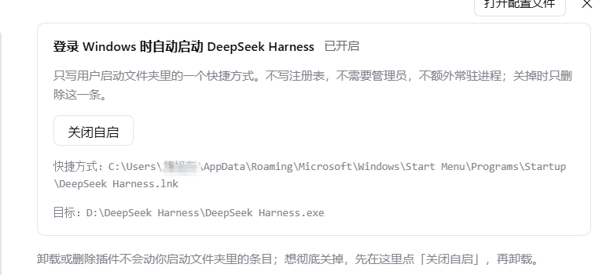
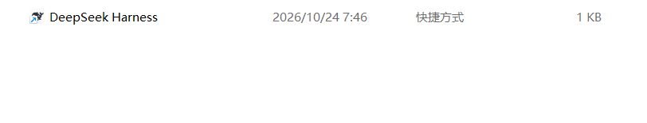

# dsh-desktop-autostart

让 DeepSeek Harness **桌面版**随 Windows 登录自动启动的一个小插件。装好之后设置里多一个开关，打开就往启动文件夹里放一条快捷方式，关掉就删掉。



## 安装

```bash
dsh plugin add dsh-desktop-autostart
```

没有 npm 的话也可以从 GitHub 装：

```bash
dsh plugin add github:QiYunqv-jxd/dsh-desktop-autostart
```

装完去「设置 → 开机自启」打开开关。默认是关的，装上看不出任何变化。

## 起因

我每次用 DSH 都要手动点开，就想给它加个开机自启动。

翻了社区里带 autostart 的插件，发现它们要么起一个 `dsh web` 后台服务，要么自己再加一层托盘、桌面的壳。我用的就是官方桌面版，所以写了个专门把桌面版放进启动项的插件。

## 做了什么

- 设置页：「设置」左栏多一项「开机自启」，里面一个开关、一个文件名（默认 `DeepSeek Harness.lnk`）
- 指向当前正在跑的桌面版 exe，路径没有写死
- 自检：条目在不在、指向对不对；顺带只读扫一遍注册表 `Run` 键和计划任务，别处还有指向 DSH 的自启就在设置页提示一行（只提示，不动它）
- 写后读回、删后确认，任何一步失败都会报错，不会静默留下坏状态



## 原理

就是在 Windows 的启动文件夹里放一个快捷方式：

```
%APPDATA%\Microsoft\Windows\Start Menu\Programs\Startup
```

创建和删除走 `WScript.Shell` COM（用 PowerShell 调一次），不写注册表、不建计划任务、也不需要管理员权限。

## 现状

v0.3。自启引擎、设置页开关、其他来源提示都写完了，开关在「设置 → 开机自启」。扫描只读，不改注册表和计划任务。

## License

MIT
